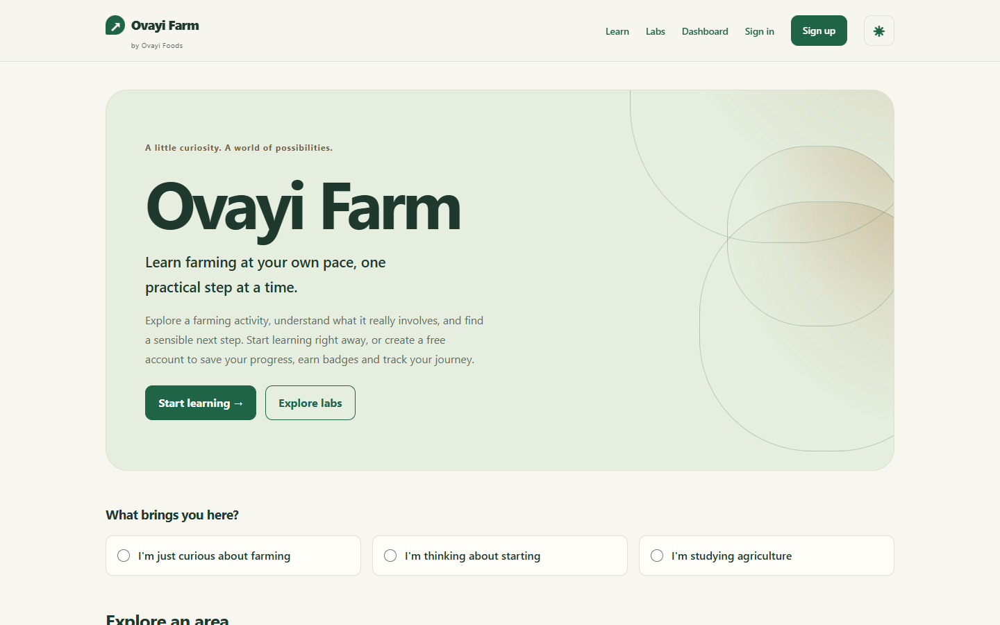
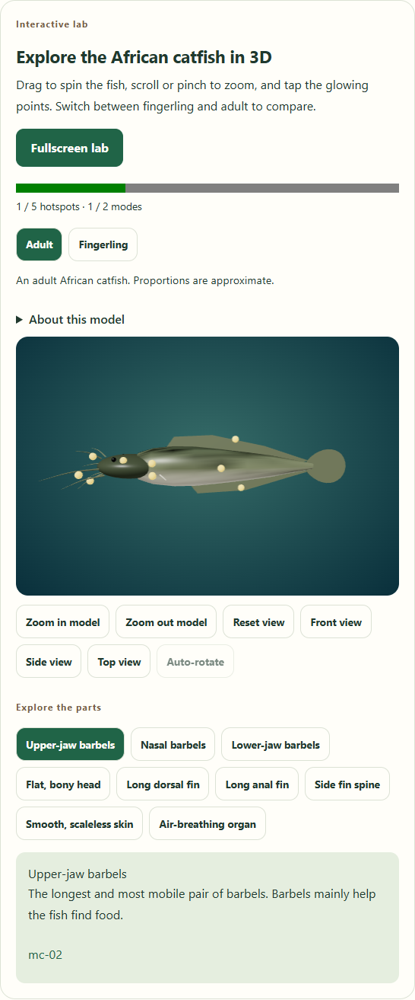
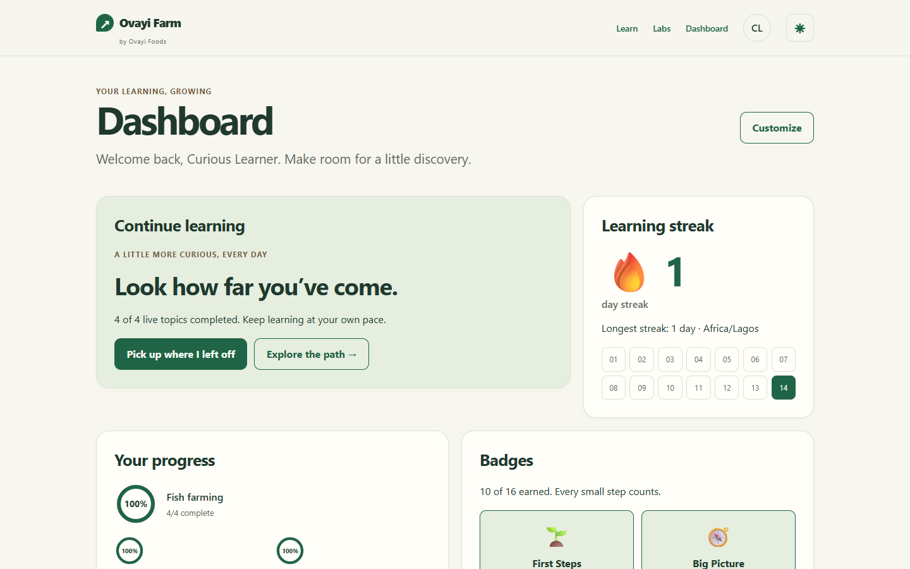

# Ovayi Farm · by Ovayi Foods

A responsive learning app for curious beginners in Nigeria. Guests can explore freely; optional accounts keep progress across visits. Choose an area, follow the fish-farming path, read a cited lesson, try a lab, ask the source-grounded guide, and complete an activity at your own pace.

Four of the five fish topics are live: What is fish farming; Meet the African catfish; Water; Space and setup options. Time, costs and commitment, other subjects, Crop farming and Agro-processing remain coming soon.

## See the app





These desktop screenshots come from the mock-mode browser journey. Mobile layouts are exercised at 375px, with additional overflow checks at 768, 1280 and 1440px.

## Features

- Credited local photos with a zoom/pan/rotate lightbox, source links and a full credits page.
- Four hands-on labs: procedural 3D catfish, water-source simulator, pond builder and illustrated warning-sign observations.
- Topic-specific understanding checks, a cited guide, inclusive activities, feedback and next steps.
- Optional accounts with guest-progress merge, saved lab results, badges, Lagos-day streaks and a customizable dashboard.
- Light/dark themes, reduced motion, keyboard controls, clear failure states and guest learning when accounts are unavailable.

## Setup

Use Node.js 24 and npm. In a fresh checkout:

```powershell
npm install
Copy-Item .env.example .env.local
```

Keep an existing `.env.local` when returning. It is private and ignored by Git. The prepared hackathon workspace already has dependencies and browsers; automated phase work does not install packages.

Set up accounts locally with these commands in the project folder. The random secret is captured without printing it:

```powershell
$env:NEXTAUTH_SECRET = node -e "process.stdout.write(require('node:crypto').randomBytes(32).toString('base64url'))"
$env:NEXTAUTH_URL = 'http://localhost:3000'
$env:DATABASE_URL = 'file:./data/ovayi.db'
$env:GUIDE_MODE = 'mock'
New-Item -ItemType Directory -Force data | Out-Null
npm run db:migrate
npm run dev
```

Open [localhost:3000](http://localhost:3000). Keep the same `NEXTAUTH_SECRET` across restarts. Save the captured value privately in your own `.env.local` for later sessions; never print, commit or share it. Drizzle CLI uses process environment variables, so set `DATABASE_URL` in the terminal before running local migrations.

The variable reference is [.env.example](.env.example): `NEXTAUTH_SECRET`, `NEXTAUTH_URL`, `DATABASE_URL`, optional remote `DATABASE_AUTH_TOKEN`, `GUIDE_MODE`, and optional `OPENAI_API_KEY` / `OPENAI_MODEL`. Server credentials must never use a `NEXT_PUBLIC_` prefix. Missing account configuration produces a friendly fallback; guest lessons remain available.

## Mock vs live guide

`GUIDE_MODE=mock` is the default: deterministic topic excerpts and rubric feedback, with no API key or external AI call. For live mode, set `GUIDE_MODE=live`, `OPENAI_API_KEY` and `OPENAI_MODEL` in your private environment, then restart. The configured model must support the Responses API structured output used by the existing provider.

The guide only answers from the requested topic's chunks. Citations, rubric ids and next steps are validated against that topic. Unsupported questions get an honest limitation and an authored next step. A live-provider failure uses the labelled mock fallback. A failed browser request retains the question and offers **Retry guide**. All tests explicitly use mock mode.

## Accounts and data

Sign up midway through a lesson to merge device progress and learning events into the account. Guest stores clear only after both transfers succeed. Signed-in saves are debounced; failed saves retain current work in memory and offer retry. Signing out flushes pending work; signing back in restores account progress.

The database holds users, topic/check/activity progress, lab results, events, guide history and dashboard preferences. Passwords use bcrypt hashes; sessions use next-auth JWTs. Account API routes validate requests and only read/write the signed-in user's rows. `/account` edits profile, state, intention and theme, changes passwords and deletes the account together with its data.

Guests use device storage (`agri-progress-v2`, `agri-events-v1`); blocked storage falls back to memory for that page session. Account work stays out of guest storage. Themes persist on the device and, when signed in, in the account. Events contain small identifiers/status fields rather than question or activity text, and are not sent to an analytics service.

The dashboard shows continue learning, topic progress, Lagos streak/calendar, badges, activity, reading-time estimates, reflections, guide history, labs, checks and profile. Customize it by hiding widgets or reordering them with handles or labelled arrow buttons; the layout persists.

## Labs

| Lab | Interaction | Completion |
|---|---|---|
| Catfish model | Orbit/zoom, view presets, auto-rotate, body-part hotspots, adult/fingerling modes | Authored hotspot and mode counts |
| Water-source simulator | Sources/photos, animated year, supply vs need, dry shortfalls, cited questions | Three sources explored and both questions correct |
| Pond builder | Snap/drag SVG sides, depth stick, numeric dimensions, area/volume/litres, references and setup types | Two authored challenges |
| Spot the warning signs | Animated pond scenes, signs and neutral elements, cited explanations and remedy | All three scenes; scored results |

All results save under `progress.labs` and feed badges. [Labs](/labs) provides lightweight previews and links into lessons. The 3D geometry is procedural and local (4,660 rendered triangles in the current test); no remote model is downloaded. WebGL-unavailable devices get a credited illustration and equivalent hotspot list. Labs and the dashboard chart load lazily. All lab controls work by keyboard; motion respects the system preference.

Water numbers are labelled fictional examples. Pond calculations use the authored simplified box formula and disclaimer about sloping banks. These tools do not predict real farm conditions or provide engineering/cost recommendations.

## Content, credits and licenses

Humans maintain `content/` and `public/media/`; automated phase work treats them as read-only. Follow [content/README.md](content/README.md) for catalog/path/topic schemas, lesson chunks, `::figure` / `::lab` directives and media/lab/badge registries. Keep ids stable, cite known sources and run integrity tests and browser gates after edits. Technical agricultural claims require cited support.

[Credits](/credits) lists every media item and reference. The ten local images use CC BY-SA 3.0/4.0, CC0 or public-domain licenses as recorded in [media.json](content/media.json). Keep attribution, source and license links with each image; respect share-alike requirements for adapted CC BY-SA images. Source references live in [sources.json](content/sources.json). No blanket license is implied for third-party media or referenced publications.

**Internal review note:** the material is sourced but has not been reviewed by a fisheries expert. Expert review and learner validation remain necessary. This note belongs in project documentation, not the learning UI.

## Testing

| Command | Purpose |
|---|---|
| `npm run dev` | Development server, port 3000 |
| `npm run test` | Mock unit/integrity tests; account tests use temporary databases |
| `npm run check` | Lint + generated route types + TypeScript + unit tests |
| `npm run verify` | Check + production build |
| `npm run test:e2e` | Production build/server on port 3100, mock mode, fresh migrated temporary database |
| `npm run db:generate` / `npm run db:migrate` | Generate / apply local Drizzle migrations |
| `npm run build` / `npm run start` | Build / serve production |

Playwright runs desktop (1440px) and touch/mobile (375px) projects. Windows uses installed Edge; other platforms use preinstalled Chromium. Browser fixtures block external requests and fail unexpected console/page errors. The full journey proves guest lesson → signup/merge → all four labs → completed topics/dashboard → saved customization → sign out/in → persisted theme. Separate cases cover keyboard-only labs, credited media/lightbox, WebGL fallback, live-layout widths, recovery and engine/chart/lab loading isolation. Unit tests compute normal-text contrast ≥4.5:1 for both themes.

Reports/screenshots are in ignored `test-results/`; selected demo images are retained in `docs/screenshots/`. Production route JavaScript measurements include uncompressed and gzip sizes with the method recorded in the [build log](harness/build-log.md). Next.js 16.4's build output does not provide the old First Load JS column; measurements are identified explicitly rather than presented as build-reported values.

The Windows Codex sandbox cannot reliably build Next.js or run Playwright. Iterate with `npm run check` inside it; run verification/browser gates outside it with approval. Do not change the app to bypass this environment issue. See [AGENTS.md](AGENTS.md). Temporary SQLite files may remain in the OS temp directory on Windows until native handles close. Tests never use `data/ovayi.db` or real deployment credentials.

## Deploy to Vercel + Turso (human steps)

These instructions are for the human. No database creation, remote migration, push or deployment was executed by the agent.

1. Finish `npm run verify` and `npm run test:e2e`. Review the diff, and arrange an approved repository push yourself. Use a separate database for preview testing.
2. Install/authenticate the Turso CLI yourself following [Turso CLI installation](https://docs.turso.tech/cli/installation). Create a database and capture its URL/token in your terminal:

   ```powershell
   turso auth login
   turso db create ovayi-farm
   $env:DATABASE_URL = turso db show ovayi-farm --url
   $env:DATABASE_AUTH_TOKEN = turso db tokens create ovayi-farm
   ```

   Store the token privately; do not echo it or paste it into source control. The URL should be `libsql://…`, not a local `file:` path. See [create](https://docs.turso.tech/cli/db/create), [URL lookup](https://docs.turso.tech/sdk/rust), and [database tokens](https://docs.turso.tech/cli/db/tokens/create).
3. Apply the repository's existing migrations to that remote database using the installed libsql/Drizzle runtime. The local `db:migrate` script's SQLite CLI configuration has no remote token field; use this authenticated remote command instead. Verify the target URL privately before running it. This changes the remote schema:

   ```powershell
   @'
   import {createClient} from '@libsql/client';
   import {drizzle} from 'drizzle-orm/libsql';
   import {migrate} from 'drizzle-orm/libsql/migrator';
   const client=createClient({url:process.env.DATABASE_URL,authToken:process.env.DATABASE_AUTH_TOKEN});
   try { await migrate(drizzle(client),{migrationsFolder:'drizzle'}); }
   finally { client.close(); }
   '@ | node --input-type=module
   ```

   Run this from the repository root. Migrations are applied before the first account request; the app does not automatically migrate production.
4. Import the repository into Vercel, choose the Next.js framework preset and [Node.js 24](https://vercel.com/docs/functions/runtimes/node-js/node-js-versions), and use the repository root. Keep the standard `npm run build` command.
5. Configure server environment variables for the intended Vercel environment: `DATABASE_URL`, `DATABASE_AUTH_TOKEN`, a newly generated private `NEXTAUTH_SECRET`, `NEXTAUTH_URL` matching the final HTTPS origin, and `GUIDE_MODE=mock` for the first demo. Generate/capture the secret using the setup command above; preserve it across deployments. If enabling live AI later, add `OPENAI_API_KEY` and `OPENAI_MODEL` privately. Never prefix secrets with `NEXT_PUBLIC_`. Follow [Vercel environment variables](https://vercel.com/docs/environment-variables).
6. Deploy from Vercel yourself. If the final origin changes, update `NEXTAUTH_URL` and redeploy; environment changes apply to a new deployment. See [managing environment variables](https://vercel.com/docs/environment-variables/managing-environment-variables). Keep preview environments on a separate Turso database and secret.
7. Smoke-test HTTPS signup/signin, guest merge, a saved lab, dashboard customization, signout/signin and image credits. Confirm the mocked guide works before choosing live mode. Retain private backups/token rotation procedures for the database.

## Known limitations

English only; four live fish topics and one coming soon. No email delivery or email password reset: **Forgot password** links to the authored admin contact. No OAuth, payments, peer groups, offline/PWA caching, translations, live reminders or diagnosis. Reminder controls are explicitly demo-only. Saved progress and streaks are activity measures, not evidence of long-term retention. Mock success does not establish live-model accuracy.

The human handles expert review, production-secret management, remote migrations, push and deployment. Project scope: [product spec](agritech-learning-brainstorm.md), [outcomes](GOALS.md), [phase status](PLANS.md), [verification evidence](harness/build-log.md).
